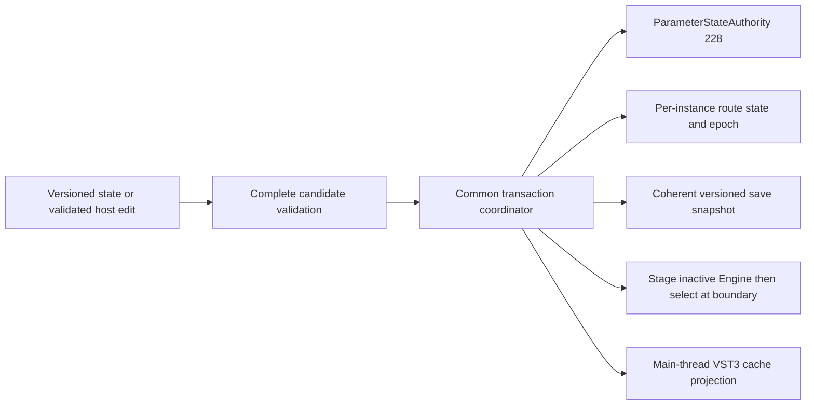

# P15-M2F persistent modulation design — proposed contract

2026-11-03. **PASS — architecture and standalone contract only.** No production
LXRS v2 codec, VST3 parameter, persistent route or DSP behavior is implemented.
The independent design exception is authorized while P15-M2E strict certification
remains **BLOCKED** (57 PASS / 1 historical FIR O2 policy block / 0 FAIL).
That executable was not retried. Earlier evidence/classifications are unchanged.

Branch `p12b-4c-fir-resampler`; starting and ending HEAD
`0091651720cacbcb2ecd3172bd667581ffb83415`. Reference is SonicPotions/LXR
`dee49689f3f0cdf8f9b7b5e79628cfdca1b79394`, not Catalyst. iPlug2
`d54f69050f517e43b941d88c2a170f0a840b9ee4`; SDK root
`3cdf9ca5d1f5b1b21e0a86832aa4abe55607bd96` plus seven pinned SDK modules.
Original custom non-commercial/full-source licence continues to cover derived
contracts, metadata and fixtures. No GPL/AGPL dependency is introduced.

## Identity and evidence boundary

| Original identity category | Count | Persistence meaning |
|---|---:|---|
| Ordered AVR rows | 205 (0–204) | Exact row identity, never a compressed seven-bit list |
| Explicit off | 1 | Canonical disabled record |
| Normal voice-menu non-off rows | 203 | Original availability, not blanket runtime approval |
| Normally automation-only global row | 1 | Represented in original metadata, rejected by current routes |
| Non-null references / physical fields | 204 / 198 | Different counts; six coarse/fine alias pairs |
| STM32-only non-menu targets | 7 | Reserved future namespace, currently rejected |
| Verified own-voice scalar rows | 107 | 101 fields, 39 indices >127; each source supports only its owner |
| Persistent assignments | 12 | Six velocity + six LFO, two hats share native owner 5 |

Typed metadata describes target identity, source, owner, scope, type, availability,
original row and version. It is not a live pointer registry. Unsupported global,
cross-voice, trigger-consumed, LFO-control and mutable destination-storage targets
remain unsupported. Row 204 is a real MIDI-note-filter row outside the reviewed
subset; 203 is the highest active profile-1 index. This distinction is tested.

Original AVR front-panel/preset selection translates table index to actual PAR;
the DSP owner is independent of the LFO menu voice hint. Original STM32 MIDI
selector handlers, AVR front-panel selectors, preset bytes and sequencer target
numbers are separate protocols. Physical AVR NRPN relay behavior remains
UNVERIFIED. Existing plugin CC/NRPN mappings and opaque selector bytes keep their
certified meanings; no physical relay behavior is invented.

Main source anchors: `dsp/ModulationContract.h` and generated data; original
`front/LxrAvr/Menu/Cc2Text.c`, `Menu/menu.c:1569–1618`,
`Preset/presetManager.c:258–287`; STM32 `MIDI/frontPanelParser.c:428–451,538–547`
and `DSPAudio/modulationNode.c:138–216`. Source hashes: out/p15-m2f/source_evidence.json.
The source-defined native order remains converted-base restore, held velocity,
LFO owners in order with immediate narrowing, filter coefficients and rendering.

# Persistence architecture decision

**Select B: a bounded LXRS v2 TLV container.** Use an independently versioned
routing payload (C's useful separation) and twelve appended host parameters
(D's controls). B is the primary persistence architecture. This is a proposed
plugin extension, not an original hardware kit format or a production change.

| Criterion | A: fixed v2 routing tail | B: versioned TLVs (selected) | C: separate module container | D: expanded parameters + persistence |
|---|---|---|---|---|
| Firmware fidelity | Can preserve full original indices | Preserves exact row, PAR/type, source/owner and alias key | Same if module identity is explicit | Values must denote stable original identities, never list positions |
| Legacy projects | Explicit v1 branch required | Explicit v1/legacy branches; routes off | Outer-version migration plus module migration | Append IDs only; never reinterpret 149–154/161–172 |
| Automation | Needs a separate control design | Paired with D; one route per stable proxy | Same independent requirement | Provides host recording/playback but cannot by itself persist structured metadata |
| Controller sync | Requires generation-aware projection | Joint patch/routes generation; durable per-control acknowledgement | Risk of independent module projections unless coordinated | Actual controller cache must be updated; IParam alone is insufficient |
| Corruption | Simple fixed lengths, less extensible | Bounded lengths, canonical tags, full-container CRC, mandatory-data rejection | More nested length/version checks | Parameter values alone cannot validate source/identity profile coherently |
| Realtime | Fixed candidate and bounded apply | Fixed candidate; decode outside processing; bounded staged apply | Safe if no module allocation/lazy loading on processing | Validated integer deltas, no dynamic list or pointer mutation |
| Multi-instance | Per-instance snapshots | Per-instance authority/queue/staging/generations | Per-instance module lifetime must be enforced | No global selector/editor authority |
| Sequencer | A second fixed tail or top-version bump | Separately versioned future mandatory tag; no step schema assigned now | Natural module isolation, larger coordinator surface | Locks need transient overlays; parameter IDs are not sequencer storage |
| Morphing | Extra fixed fields/versioning | Future morph tag; explicit discrete route policy | Good isolation, still needs common transaction | Never interpolate route IDs |
| Core plugin bytes | 500 with the same routing body but no TLV header | **516**, plus 4-byte existing bypass suffix | At least B-equivalent structure; another container adds its own header | Twelve host descriptors are not twelve serialized native bytes |
| Migration complexity | Low initially; grows with each feature | Moderate once; explicit skip/preserve/reject rules | Highest if module versions are allowed to evolve independently without a common epoch | Significant host/controller work regardless of wire choice |
| Testability | Easy initial fixed vectors | Independent vectors, bounded parser, unknown-tag/version/corruption tests | More version combinations | Exhaustive normalized round trips plus later actual host tests |
| Maintenance | Coupled top-level versions for unrelated features | Frozen core plus explicit capability/module versions | Useful only inside the selected common envelope | Necessary complement, not a substitute for a state envelope |

A saves only 16 bytes for this payload and makes future mandatory feature data
harder to evolve independently. C is adopted as routing-payload versioning, but
not as separate independently committed plugin state: a patch and its routes
must restore together. D is adopted for host controls, but putting routes in the
old seven-bit patch or relying on host parameter restoration order is rejected.
The choice follows identity, automation and transaction requirements, not merely
serialization convenience.

# Normative proposed LXRS v2 wire schema

All integers are unsigned fixed-width little-endian unless stated. Fields are
written explicitly; no C++ object layout, bool layout, enum ordinal, pointer,
padding, phase, PRNG state or temporary effective value is serialized.
This schema changes **v2 only**. The existing v1 definition is immutable.

## Top-level header

| Offset | Width | Field | Required value / meaning |
|---:|---:|---|---|
| 0 | 4 | magic | ASCII `LXRS` |
| 4 | 2 | format_version | 2 |
| 6 | 2 | header_bytes | 32 |
| 8 | 4 | plugin_bytes | Exact size excluding VST3 bypass suffix |
| 12 | 2 | parameter_count | 228 |
| 14 | 2 | flags | 0 |
| 16 | 4 | parameter_bytes | 228 |
| 20 | 4 | extension_bytes | plugin_bytes − 260 |
| 24 | 4 | crc32 | IEEE CRC-32 over all plugin_bytes, treating bytes 24–27 as zero |
| 28 | 4 | reserved | 0 |
| 32 | 228 | patch | Original IDs 0–227 in ascending order; every byte 0–127 |
| 260 | variable | TLVs | Canonical ascending tag order, no padding |

CRC: reflected polynomial 0xEDB88320, init/final XOR 0xFFFFFFFF; the check vector
`123456789` is 0xCBF43926. This covers the header, patch and every TLV header/body.
It detects corruption, not malicious modification or authenticated provenance.

Maximum plugin_bytes is **4092** and maximum VST3 stream is **4096**, preserving
the existing stream bound. Even core-only v2 input is limited to 4092; overflow
is checked before addition/subtraction/copy. extension_bytes is at most 3832.
There are 1–16 TLVs. Exact length is required; arbitrary trailing bytes reject.
The transport adapter requires exactly four additional bypass bytes for VST3;
the core decoder, used outside that transport, requires none. The bounded read
must consume the complete stream and detect one byte beyond its maximum.

## TLV header (16 bytes)

| Relative offset | Width | Field |
|---:|---:|---|
| 0 | 4 | tag; 0 reserved, 1 routing |
| 4 | 2 | record_version |
| 6 | 2 | flags; bit 0 REQUIRED, every other bit zero |
| 8 | 4 | body_bytes, excluding this 16-byte header |
| 12 | 4 | reserved, zero |

Each tag occurs at most once and tags strictly increase. Routing tag 1 must be
present, REQUIRED=1 and record_version=1. Its body is exactly 240 bytes.
Unknown REQUIRED tags reject the entire candidate. Unknown optional tags retain
their exact tag/version/body bytes and survive save/load; they cannot change
DSP semantics. Unknown optional versions are preserved. Known routing versions,
profiles or identity-table revisions that are unsupported reject even if marked
optional. Reserved flags/fields reject rather than being silently ignored.
Any future feature that affects sound or interpretation must use mandatory data.
No sequencer or morph TLV body/tag is finalized in M2F.

## Routing module header (48 bytes)

| Relative offset | Width | Field | Value |
|---:|---:|---|---|
| 0 | 2 | module_version | 1 |
| 2 | 2 | route_bytes | 16 |
| 4 | 2 | route_count | 12 |
| 6 | 2 | capability_profile | 1 = verified own-voice scalar subset |
| 8 | 4 | identity_table | 1 = original SonicPotions v0.37 AVR table |
| 12 | 32 | table_sha256 | Raw SHA-256 of pinned original AVR Menu/Cc2Text.c |
| 44 | 4 | reserved | 0 |
| 48 | 192 | routes | Twelve 16-byte records |

Table digest is
`9A264F0DFD6B3EE6C88D884A3859270AFCEB7B9F4FB0F25B75CCD02C74CF11AE`.
It binds the exact table/source revision at firmware commit
`dee49689f3f0cdf8f9b7b5e79628cfdca1b79394`. The digest is stored as 32 raw bytes,
not hexadecimal text. Profile 1 is frozen at the existing 107 rows; a later
profile must require an explicit upgrade, never silently activate previously
unsupported automation in an older project.

## Route record (16 bytes)

| Relative offset | Width | Field | Meaning |
|---:|---:|---|---|
| 0 | 1 | owner | 0 D1, 1 D2, 2 D3, 3 SN, 4 CY, 5 shared HH |
| 1 | 1 | source | 0 velocity, 1 LFO |
| 2 | 2 | flags | 0 disabled, 1 enabled; all other values reject |
| 4 | 2 | identity_namespace | 0 off, 1 AVR v0.37; 2 reserved STM32 namespace |
| 6 | 2 | original_index | Exact full-width AVR row; active 1–204 structurally |
| 8 | 2 | firmware_parameter | Original PAR derived from that row |
| 10 | 1 | value_type | 0 UInt8, 1 Float, 2 frequency multiplier, 3 UInt32; 255 off |
| 11 | 1 | scope | 0 none/off, 1 voice, 2 global |
| 12 | 2 | physical_key | Minimum original PAR in the row's physical-storage alias class |
| 14 | 1 | menu_voice_hint | Velocity requires 0; LFO permits 0 unspecified or original 1–6 hint |
| 15 | 1 | reserved | 0 |

Records are ordered velocity owners 0–5, then LFO owners 0–5. Duplicate, missing
or reordered source/owner records reject. No seventh LFO or velocity owner exists;
both hat tracks use owner 5. A disabled record retains only source and owner:
flags/namespace/index/PAR/scope/physical_key/hint/reserved all zero, value_type=255.
There is no hidden remembered active target in disabled state.

Validity/availability is derived deterministically from table 1 + profile 1 +
source/owner and verified metadata; no untrusted stored Boolean grants support.
The stored PAR/type/scope/physical key must match the original row exactly.
The physical key is a **wire-defined original PAR**, not the current C++
DestinationId enumeration. Coarse/fine rows retain separate original indices
while sharing a physical key. This preserves the selected row without duplicating
runtime converted-base ownership. The LFO menu hint is advisory metadata and
never retargets a row, including when it disagrees with the actual voice.

Namespace 2 is reserved for a future reviewed STM32-only identity profile; all
such active records reject now. Values 205–65535 in the AVR namespace reject.
Original row 204 is structurally real but is a MIDI-note-filter target outside
profile 1; highest accepted profile-1 index is **203**. Unsupported routes are
never remapped to another row or converted to off silently.

Canonical core size: 32 + 228 + 16 + 48 + 12×16 = **516 bytes**; VST3 = **520**.
Optional data has at most 3576 bytes remaining, including its TLV headers.

## Migration and downgrade

V1 branch: validate exactly the unchanged 24-byte header, 228-byte payload,
v1 payload-only CRC, seven-bit domain and original length rules. Preserve every
byte including slot 0 and opaque selector slots. Create all twelve canonical
off records; preserve bypass and existing defaults. Never infer any route.
Legacy branch: retain the exact validated 228 native-endian IEEE-754 x64 doubles
(1824 bytes), finite/integral/0–127 checks and existing bypass handling. It is
a historical Windows ABI import, not a new portable double wire format. Routes
start off. An absent state uses existing plugin defaults, not an invented kit.

V2 branch: validate the **whole** bounded envelope and all records before logical
publication, IParam projection, bypass change or engine mutation. Unknown top-level
versions reject; no fallback to v1/legacy after an LXRS magic/version mismatch.
V1/legacy read support remains indefinitely. New saves would use v2 only after a
separately authorized production implementation. Old builds are not expected to
read v2. There is no silent lossy v1 export; any future downgrade operation must
refuse active routes/retained extensions or explicitly disclose loss under a
separately approved policy.

The existing framework suffix remains a signed int32 bypass value: zero is off,
nonzero is on, and new framework-compatible saves write 0/1. Logical bypass state
is preserved; noncanonical historical integer bit patterns need not be reproduced.
The suffix is outside the LXR CRC. A future LXR-local `setState/getState` adapter
must validate/read it before any publication: the current shared wrapper reads
and seeks for it after UnserializeState, which cannot by itself guarantee rollback
on a later stream seek/read failure. No framework or plugin adapter is edited here.

# Authoritative ownership, ordering and restore contract

This is a required future plugin-shell change, **not implemented by M2F**.
`ParameterStateAuthority<228>` remains the sole original-patch authority and is
not widened or edited. Add a separate per-instance RouteState (12 records),
bounded opaque optional-record storage, bypass mirror and a common coordinator.
Separate patch/routes authorities without a common transaction are rejected.

## Common transaction protocol

Every original-patch producer (host/UI/MIDI/restore), route producer, serializer,
controller projector and reset snapshot must enter the same outer coordinator.
It uses one lock-free atomic_flag try-acquire, **one attempt, no spin**. Acquire
order is always outer coordinator then existing ParameterStateAuthority handle;
release the inner handle before releasing the outer gate. A failed inner claim
must occur before any writes and cancel the untouched outer operation. No
transaction handle survives a callback or is held over a host callback.

Route/extension arrays can be ordinary fixed arrays because *all* accesses are
inside that acquire/release gate. Never use an ordinary-payload seqlock with
unsynchronized array reads. The audio thread reads only through a successful
bounded snapshot, then exclusively owns its processing banks. Existing atomic
patch payload does not by itself make separately read routes coherent.

Writers validate their complete candidate before gate acquisition. Under the
gate, obtain the existing patch writer, update the patch authority and route/
extension/bypass state, commit the patch handle, publish a monotonically increasing
joint generation with release semantics, then release the outer gate. That
joint-generation publication is the logical transaction commit. Single-field
route edits use the same joint generation (without replacing patch bytes).
Readers try the outer gate once, use one existing patch snapshot attempt, copy
routes/metadata/bypass into fixed caller-owned storage, then release. The snapshot
linearizes while holding the gate after pending edits required for that snapshot
have been serviced. It is coherent even though SDK parameter getters are separate
eventually synchronized queries rather than a 240-control atomic read API.

Full restore: bounded stream read and complete validation, including bypass and
all mandatory records, happens outside processing. A busy coordinator returns
state-load failure without publication; a full restore is never partially queued.
On acceptance increment restore epoch, allocate a restore-order ticket under the
gate and atomically commit the complete logical candidate as above. Mark runtime
reset in that same joint commit, before any reader can treat it as ordinary edits.
No IParam/controller/bypass update precedes candidate acceptance. In particular,
the future LXR-local VST3 state override must read/validate the entire IBStream
before publication; returning a payload position and letting the current shared
wrapper seek/read the suffix afterwards is insufficient for failure atomicity.
Override hooks exist in IPlugVST3::setState/getState; do not broaden shared iPlug2
patches without separate authorization. Transport failure tests are mandatory.

## Contention, tickets and stale work

Nonblocking audio producers use a fixed deferred command queue when a direct
joint transaction is unavailable. Requirements for the later concrete queue:
4096 cells, each at most 48 bytes, at most four reservation CAS attempts,
sequence-numbered release publication/acquire consumption; no overwrite, heap,
waiting or incomplete-cell spinning. Queue acceptance linearizes at the cell's
release publication. QueueFull/reservation contention rejects the new request
without changing authority; a durable counter and main-thread reconciliation
make this observable. A void audio callback cannot promise unlimited lossless
delivery from finite storage; saturation is an explicit rejected edit, not a
successful silent mutation. Controller APIs return failure where supported.

Each request takes an unsigned 64-bit intent ticket at entry; each logical field
tracks the latest committed ticket. A full restore establishes a global cutoff
ticket and a new epoch. Deferred pre-cutoff edits are superseded, not replayed
onto the new project. Deferred post-cutoff edits apply only when newer than that
field's committed ticket. This prevents an older queued command overwriting a
newer direct command. A route-editor batch carries its captured restore epoch;
stale editor work rejects even if it obtains a newer ticket after reload. Host
automation delivered after reload is a new command; never infer a project epoch
from the numeric destination token. Full editor batches use the immediate common
transaction or return Busy; they are not split into queued individual assignments.
No epoch/ticket is serialized. Refuse new publications before uint64 wrap; require
a stopped lifecycle reset rather than inventing cross-wrap comparisons.

Processing drains at most 4096 ready commands per boundary and performs at most
two complete logical snapshot attempts. Incomplete reserved cells stop that drain
without waiting. A busy snapshot retains the previous complete processing bank.
SerializeState captures a queue watermark, services the accepted ready prefix up
to that watermark, then snapshots under the gate; if the bounded service cannot
complete, return failure rather than save a successful state omitting an already
accepted pending edit. Later accepted edits belong after the save linearization
point. Exact ticket allocation, queue cell lifetime and memory-order proofs plus
forced concurrency/overflow tests are required before production acceptance.

The current plugin's patch mailboxes contain unbounded compare_exchange loops
in OnParamChange and restore cleanup. They must **not** be copied into this new
protocol or assumed to satisfy these bounds. Replacing/rerouting those plugin-local
fallback paths is a subsequent implementation dependency; no changes are made
to the existing authority class or any callback here. The prototype models
ordering/cutoff/epoch/overflow semantics sequentially, not a verified MPSC algorithm.

## Processing projection and exact restoration order

Preallocate two per-instance Engine banks and bounded candidate/control storage
outside processing. Engine contains non-owning table views and no heap members;
copying its native state is already exercised by M2E. Never call loadAssets while
staging; asset lifetimes must span both banks. Do not copy/reconfigure the large
FIR coefficient bank on every route edit.

For a complete restore, stage the inactive Engine:

1. Initialize all voices/LFOs/routes/held sources using the existing Engine init.
2. Replay original patch IDs 0–227 in ascending order through existing setters.
3. Configure velocity owners 0–5 then LFO owners 0–5 with explicit full-width rows.
4. Check every native return status; profile 1 and capacity 12 must make these
   valid. If an unexpected status occurs, retain the previous complete active
   bank and applied generation; report a diagnostic outside processing. Do not
   activate a partial bank or silently disable only a failed route.
5. On successful staging, select the inactive bank as the new audio-owned bank,
   reset the existing adapter history/cache and MIDI parser with their no-fail
   bounded reset operations, mark the applied generation, then process deferred
   MIDI in its retained FIFO order. No render/event consumer runs between these
   operations; that boundary is the processing projection linearization point.

On ordinary edits, copy the active Engine to the inactive bank, replay only the
changed base parameters, apply changed route nodes in velocity-then-LFO owner
order, then select that bank after all checks. Do not reset voices, phase, held
velocity or FIR history for ordinary route automation. Native cached audio stays
intact. Valid route reconfiguration retains the original restore-all-effective-
fields side effect; the next native tick restores converted bases, replays held
velocity 0–5, advances/evaluates/dispatches LFO 0–5 with immediate narrowing,
recalculates affected coefficients, then renders. No serialized effective field,
old base mirror, host cache or pointer can overwrite the newer raw base.

MIDI remains processing-owner-only. A MIDI event meeting an unapplied restore
must remain in the existing bounded FIFO; replay begins only after the complete
patch+routes bank is active. A CC/NRPN changes a saved base under the common
coordinator before corresponding projection; note/velocity never changes saved
route assignments. Preserve existing overflow semantics and current MIDI mapping.
Stopped-processing callbacks use the same ownership protocol; do not assume
OnReset can write an Engine while process() is active.

Proposed control-storage cap is 256 KiB per instance, excluding existing assets
and FIR bank: queue <=4096×48 bytes, fixed logical/snapshot/optional storage,
generation arrays and one extra 3840-byte Engine fit this budget. Require actual
sizeof/static assertions, allocation instrumentation and bounded-operation counts
in the next milestone. This is a design budget, not a measured new runtime cost.

Controller synchronization follows the separate host-control contract. Cache
projection uses accepted logical state; rejected/pending values are not competing
authority. Release all gates before host callbacks, retain unacknowledged
generations, and reconcile the same connection/restore epoch on retry.

## Existing asset boundary

Engine::loadAssets currently writes static waveform buffers and a shared transient
store during initialization. M2F introduces no such sharing for routes, snapshots,
queues or Engine banks. The proposed staging never reloads assets; existing views
are read-only during processing. Concurrent initialization/reloading of that
pre-existing shared asset storage needs a separately scoped lifecycle review;
do not claim M2F resolves whole-plugin asset-lifetime isolation. This issue is
recorded, not repaired, and no source/binary integrity defect occurred in this task.

# Proposed VST3 host controls

Append twelve stable IDs without changing IDs 0–227 or certified MIDI mappings:

| Owners | Velocity destination IDs | LFO destination IDs |
|---|---|---|
| D1, D2, D3, SN, CY, HH | 228, 229, 230, 231, 232, 233 | 234, 235, 236, 237, 238, 239 |

One destination belongs to each source; the source owner is fixed by its ParamID.
Names are `D1 Velocity Dest` … `HH Velocity Dest`, `D1 LFO Dest` … `HH LFO Dest`.
Amounts/waves/rates remain the existing patch parameters. No new selector MIDI
CC/NRPN address or reassignment of legacy opaque selector IDs is proposed.

Keep native count 228 separate from proposed total host count 240. The current
constructor's equality assertions and NParams-based loops need a scoped future
shell update; never extend ParameterArray or ParameterStateAuthority to 240,
feed route IDs to their uint8 setters, or use GetRawLXRParameterValue's seven-bit
conversion for a route token. Preserve M2A HostParameterId (0–227); introduce
distinct RouteHostParamId and RouteToken16 types with explicit source resolution.

Use `IParam::InitInt(default=0,min=0,max=65535,linear,step=1)` for these new IDs,
with VST3 stepCount=65535, canAutomate=true. This complete numerical range and the
twelve IDs are frozen for their lifetime. Token 0 is off; 1–204 are their actual
AVR table indices. Only the profile's verified own-voice 107-row union is accepted
(18 choices each for D1/D2/D3/SN/CY, 17 for HH, plus off). 205–32767 are reserved;
0x8000|PAR is reserved for a future STM32 namespace/profile with actual original
PAR identity; 0xFFFF and all remaining values are reserved. None is enabled now.
The host token and record namespace/index are converted explicitly, not cast
through a seven-bit byte. Runtime activation remains profile-validated.

This fixed 16-bit domain avoids changing old normalized automation when future
identities are added. A 0–204 lifetime parameter is attractive today but cannot
be expanded later without changing every existing normalized value. A dense
per-voice enum would tie automation to list positions. A 65,536-item enum/list
is unnecessary; use integer parameters and a future local filtered editor backed
by the same host proxies. Generic hosts can type original row numbers; their
sliders traverse reserved values, an explicit usability tradeoff. No editor is
implemented in M2F. Bank/page plus destination controls are rejected: host
playback can deliver their intermediate states separately, requiring another
transaction protocol and creating ambiguous recordings.

Formatted values: `Off`; accepted `AVR 203: HH distortion`; known unavailable
`Unavailable: AVR 204 MIDI_NOTE6`; other values `Reserved 0xHHHH`. Names come from
the frozen original metadata, not a dynamic pointer or array slot. Text parsing
must resolve a unique numeric token and validate against the source; ambiguous
names reject. No silent nearest-valid-value snapping. A rejected host write keeps
the prior authoritative route and schedules canonical readback reconciliation;
controller setters report failure where the API permits it. A local editor offers
only supported values and uses one beginEdit/performEdit/endEdit gesture per
deliberate edit. State restore, MIDI-derived changes and controller reconciliation
must not synthesize automation gestures.

## Normalization

VST3 ParamValue is double. Pinned IParam ShapeLinear maps `plain/65535` and back
to `round(normalized*65535)` because InitInt sets kFlagStepped, step 1. Use actual
ToNormalized/FromNormalized in the eventual adapter. Reject NaN/inf/outside [0,1]
before framework clamping, then validate the integer token. Positive half-way
values follow std::round (upward). Never use uint8, `int(normalized*127)`, a
float intermediate, or change max/step on later releases.

The independent suite checks every code 0–65535 through the actual pinned IParam
implementation at O0/O2, both native double and double containing float-rounded
normalized input, with no accidental aliasing. With a float32 input in [0,1],
the multiplied 16-bit quantization error remains far below half a step; observed
round trips are exact. This does not require raw normalized bit patterns to match
across hosts: the recovered integer is exact. Indices 127/128/204 preserve their
numeric identity even when a specific route is unsupported; index 205 is not an
original target. Row 203 is the highest accepted initial identity.

The prior MIDI defect was a different conversion: IPlugMidi's CC path truncates
value×127. The existing callback-scoped MIDI canonicalizer remains unchanged and
applies only to its existing synthetic MIDI IDs. New route proxies must not enter
that path. Pinned special IDs are bypass=65536, preset=65537 and MIDI CC start
65538; IDs 228–239 do not collide. ParamID and selector value are separate domains.

## Automation, state and controller convergence

Retain the pinned adapter's **last queue point per parameter per process callback**
policy initially; no sample-accurate all-point playback is claimed. Validate the
new queues before delegating/mutating IParam, consume their values as source-bound
route edits, and apply at a processing boundary. Existing generated 32-frame PCM
caches retain their contents; the new route first affects the next native tick.
Destination values are stepped selections, never interpolated IDs. Last-point
invalid input rejects that queue's edit rather than searching earlier points.
Changing this scheduling policy later needs a separate timing contract.

All accepted patch+route state has one joint generation and restore epoch.
Controller readback uses the actual separate VST3 ParameterContainer, never only
IParam. Extend the existing durable per-slot generation acknowledgements to 240
controls. Main-thread OnIdle takes the common coordination gate once, projects
the latest accepted values using SetVST3ParamNormalized, releases the gate, then
calls restartComponent(kParamValuesChanged). Acknowledgement advances only after
success on the same handler connection epoch. Busy/rejected callbacks retain
pending generations; reentry and disconnect/reconnect cannot resurrect an older
route. Actual host cache, display strings, gestures, automation playback and
reconnection still require production integration tests in the next milestone.

# Sequencer and morph compatibility — boundaries and prerequisites

Original source inspected, not Catalyst:

- `mainboard/LxrStm32/src/Sequencer/sequencer.h`: Step has seven uint8 fields,
  volume/prob/note/param1Nr/param1Val/param2Nr/param2Val. PatternSet separates
  substep arrays, uint16 main-step masks, pattern settings and length/rotation.
- `front/LxrAvr/Preset/SeqStep.h`: corresponding front-panel StepData copy.
- `sequencer.c:seq_parseAutomationNodes/seq_triggerVoice`: set both automation
  destinations, update both values, then trigger; seven track identities include
  the two hats sharing one synth voice.
- `DSPAudio/automationNode.c`: changing a lock destination restores its previous
  destination through original CC setters using originalCcValues, then the new
  raw absolute value is applied. A lock is not ModulationNode multiplication.
- `Preset/presetManager.c:interpolate/preset_morph/preset_writeDrumsetData`: raw
  interpolation uses a 256 denominator and low-byte threshold 0x7f; the comment
  calling it bankers rounding is not a substitute for the expression. Kit save
  explicitly retains velocity targets, LFO targets and LFO voice selectors rather
  than morphing their identities. Direct STM32 selector handlers are no-ops.

## Future P16 locks

Saved base patch and persistent routes remain authoritative. Locks form a separate
audio-owned raw-value overlay, never write ParameterStateAuthority or serialized
patch bytes, and do not emit host automation/cache notifications as base edits.
Seven track identities must not become seven velocity/LFO owners. Both hats
still address native owner 5 with explicit arbitration tests for two locks.

Proposed processing precedence: coherent accepted base/routes snapshot, optional
explicit morph overlay, ordered raw locks (slot 1 then slot 2 at original event
boundaries), trigger/retrigger/velocity, then existing native-tick restore/replay/
LFO/coefficients/audio order. Raw setter overlays must refresh the converted
**effective base** used by modulation without overwriting the durable saved base;
ending/changing a lock restores the latest base/morph value, not a stale captured
knob. Host/MIDI base edits during a lock update durable state and are revealed
when the lock releases. Slot alias collisions, route-change side effects, tempo,
native cache/host offset conversion and transport stop/reset need explicit tests.
This proposed overlay precedence is not a claim of full hardware sequencing
fidelity and is not implemented by M2F.

Initial future lock capability should exclude route proxy IDs 228–239 and unsafe
original selectors. Route locks require a separate typed, discrete transient
route overlay; they cannot write a pointer or numerically interpolate identity.
Pattern changes clear/rebuild transient overlays, not persistent patch authority.
Host readback represents base values unless a separately named effective monitor
is designed. Never change the meaning of the existing parameter readback silently.

Future sequencer persistence should use its own independently versioned TLV in
the same joint top-level state, mandatory whenever it affects restored sound.
Do not serialize Step/PatternSet raw layouts or bitfields. The reviewed arrays
can exceed the current 4096-byte state ceiling; P16 must first budget its full
data and separately authorize a larger top-level format/version or another
explicit bounded storage design. M2F assigns no final sequencer file schema,
compression or TLV tag and does not pretend the current envelope fits a full
pattern bank.

## Future morph

Keep two immutable source configurations and a separate transient morph overlay.
Do not repeatedly UnserializeState while moving morph: that resets voices,
routes/FIR/parser. Morph is not host automation and is not a sequencer lock.

| Data | Proposed future policy |
|---|---|
| Continuous raw sound parameters | Firmware-expression interpolation only after scalar-domain/AVR-promotion review; do not interpolate mapped Hz/filter coefficients |
| Waveform and filter type bytes | The inspected firmware interpolates raw sound bytes through the same loop where their setters consume integers; preserve only after dedicated enum-transition tests, not generic continuous DSP interpolation |
| Voice output routing | Separate discrete policy, not assumed to be inside the same sound-morph universe |
| Velocity/LFO destination identities | **Retain the active assignment** during a firmware-compatible morph; explicit A/B selection may be offered only as a separately marked extension, never numeric interpolation |
| LFO destination voice hint | Retain advisory metadata with its route; never use hint interpolation to retarget |
| Velocity/LFO amounts | Raw scalar candidates in the original sound range; confirm setter/loop coverage and timing before activation |
| Sequencer locks | Apply as independent temporary overlays after morph under the proposed precedence; never mutate anchors |

The retained route is a source-backed rule from kit save/dispatch, not a guessed
50% destination switch. Exact physical AVR arithmetic, full kit/global/morph
interactions, factory defaults, hardware relay and final host scheduling remain
unverified. No final morph persistence record or host parameter is assigned here.

## Next implementation sequence

1. P15-M2G, separately authorize a production codec/authority integration only:
   v1/legacy import + v2 bounded TLVs, full-stream/suffix validation, common
   patch/routes coordinator, staged native restore, private codec/concurrency
   tests. Keep route host parameters unregistered until this transaction path
   and unchanged existing regressions pass. No install or implicit development
   scope expansion follows from this design PASS.
2. Separately integrate the twelve stable host proxies, validation before cache
   mutation, exact normalized conversion and generation-aware controller
   reconciliation. Actual IEditController/host automation/state/overflow and
   forced overlap tests are required; pure IParam tests are not host certification.
3. Obtain separate authorization for any private plugin build/host validation,
   installation, UI editor, broader target profile, sequencer, morph or presets.
   Preserve the independent historical FIR BLOCKED classification until an
   approved exact-artifact verification task closes it. Do not retry it here.

## Independent contract verification and implementation gate

Final O0 and O2 each: **272,249 checks PASS, 0 FAIL**, exits 0. Exact commands,
compiler/source/fixture/executable hashes and raw logs are under
`out/p15-m2f/contract-003-final/`; consolidated results:
`out/p15-m2f/state_contract_test_results.json`. Earlier compile setup failure is
retained in contract-001; earlier 272,104-check passes are in contract-002.
The final expanded tests add standard CRC, ambiguity, bounded pending-overflow
and stale-drain cases; no assertion tolerance or production source was changed.

The test-only reference model is in `tests/reference/persistence/StateContractModel.h`
and its driver is `tests/P15M2FStateContractTest.cpp`; the accepted declarative
proposal is `interfaces/P15M2FPersistenceContract.h`. Independent Python struct/zlib
goldens check exact byte equality and field order, not merely encoder/decoder
self-consistency. Original AVR/STM32 C fixtures independently check PAR, type and
storage aliases. The unchanged production v1/legacy decoder is a read-only
compatibility comparator. All 65536 tokens round-trip through the actual pinned
IParam at double and float-rounded host precision. This does not certify an
actual registered VST3 parameter, live controller display, or host automation run.

Cases cover all 205 identities/12 source-owner pairs, exact 107-row support,
legacy opaque bytes and bypass, all header/payload truncations, oversize/CRC/
length/version/reserved/duplicate failures, optional retention/mandatory reject,
complete candidate validation and sequential restore/ticket/epoch/overflow rules.
The model uses test-only allocations; it is not an audio implementation or a
concurrent memory-order proof. The next milestone must test real forced writer/
reader interleavings, bounded MPSC contention, transport failures, staged Engine
return paths, actual host cache/gestures and zero processing allocations.

Additional acceptance gates for P15-M2G: preserve all original parameter IDs/
default/MIDI/v1 semantics; no automatic route activation on old state; all 12
native assignments round-trip; no partial patch/routes/bypass recall; interrupted
or stale queued work cannot resurrect old routes; budgeted storage/operation
bounds and failure signals; unchanged original-C/runtime regressions. No P16,
morphing, presets, new target capability profile, UI or installation is included.

Remaining uncertainties are physical AVR relay/hardware arithmetic/RNG/timing,
host-specific stepped display/playback behavior, concrete MPSC/memory-order
implementation and the existing shared asset initialization lifetime. No proposed
format decision depends on those unknown hardware behaviors. A full future
sequencer bank needs a separately approved state-size/version policy.

Required evidence in `out/p15-m2f/`: persistence_options.md,
proposed_state_schema.md (+ machine-readable JSON), route_validation_matrix.csv
(2460 original-row/source-owner cases), route_rejection_reasons.csv,
legacy_migration_matrix.csv, host_control_contract.md,
state_contract_test_results.json, future_feature_dependencies.md,
file_inventory.json and integrity_report.md. No historical report is overwritten.
Final classification refers only to this design contract. P15-M2E remains BLOCKED.
