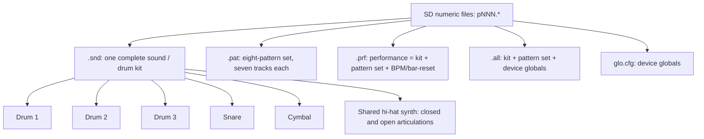
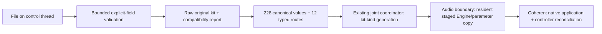

# P17-A — Original LXR preset, kit and pattern architecture audit

Audit-only result: **PASS**, scoped to source contracts and the design below. **P16-F release certification remains BLOCKED.** No production DSP/state code, plugin build, installation, preset implementation or GUI component was changed. No Git staging, commit or push is authorized or performed.

Baseline/end HEAD: `02c4005c91118d369473511e0d5a4b41e30202be`, branch `p12b-4c-fir-resampler`, origin `https://github.com/vlndv/lxr-vst3.git`; live branch verified at start and completion. Remote default HEAD is a different branch and does not redefine this baseline. Original firmware `dee49689f3f0cdf8f9b7b5e79628cfdca1b79394`, iPlug2 `d54f69050f517e43b941d88c2a170f0a840b9ee4`, SDK `3cdf9ca5d1f5b1b21e0a86832aa4abe55607bd96`. Firmware/dependency archive verification passed. Catalyst was not used.

All mandatory project architecture/state/sequencer/phase documentation and F13 roadmap/report were reviewed. All458 existing source fingerprints matched the F13 baseline initially,235 production inputs and757 F13 artifact fingerprints matched, and the index/tree were initially clean. Final integrity evidence verifies the expected audit-only changes and protected installation. Full paths/hashes are in `out/p17a/baseline_inventory.json`, `file_inventory.json` and `integrity_report.md`.

The [official owner's manual v0.91](https://sonic-potions.com/public/SonicPotions_LXR_OwnersManual.pdf), pp28–30, corroborates a six-voice sound, eight-pattern set and combined settings file. The [official quickstart](https://www.sonic-potions.com/lxr-quickstart) describes SD-root installation and links the companion image. Both are secondary to the pinned source for later performance/version behaviour. The manual has its own CC BY-NC-SA3.0 Germany notice. No card image or third-party content was downloaded.

Source anchors below use the pinned `ref/LXR-0.37/` checkout. Generated evidence in `out/p17a/` includes exact source hashes, symbol line spans, caller/callee locations, raw compiler attempts and independent fixtures. The original checkout remains read-only and ignored. Derived tests retain the project's custom non-commercial licence obligations; no GPL/AGPL or paid metadata was added.


## Original hierarchy and ownership

Status: SOURCE VERIFIED at SonicPotions/LXR `dee49689f3f0cdf8f9b7b5e79628cfdca1b79394`. UNKNOWN means an explicit evidence limit, not an invented feature.



The pinned source calls the full six-voice configuration a sound preset or drumset. There is no separate individual-voice sound file, voice-preset bank format, or named complete-project bank discovered. A collection of `pNNN.snd` files is a kit collection, not a single serialized bank. No seventh synthesis voice exists: tracks 5 and 6 address closed/open articulations of the same hat owner.

| Category | Contents and ownership | Excludes | Selection, load/save, copy and naming |
|---|---|---|---|
| Individual voice | A subset of the flat AVR sound array; MCU voice/modulation objects | Other owners; no independent original file | Edited by voice selector. No independent sound-file save/load or sound-copy operation found. Future plugin extraction would be a new contract. |
| Sound/drum kit | All 228 raw AVR sound slots, including modulation selectors, six output/effect groups, global decimation and seven note overrides | Pattern bank, shuffle, running state, device globals | `preset_loadDrumset` / `preset_saveDrumset`; numeric `.snd` slot; shared eight-byte label. Morph target uses another 228-byte RAM array and the same `.snd` format. |
| Pattern | Seven tracks, 128 substep positions, main masks, lengths, next/repeat setting | Synth patch; individual file/name per pattern | Pattern buttons / global-channel MIDI Program Change. `seq_copyPattern` copies track contents; chaining metadata remains destination-owned. |
| Pattern set | Eight patterns plus set-wide shuffle | Kit, current notes/position, mutes, roll/record state, transport anchor | `.pat` loads/saves the entire set, with one eight-byte name. `seq_copyTrack` copies steps/mask/length/rotation in RAM; original file omits rotation. |
| Performance | Kit + eight-pattern set + internal BPM and bar-reset option | Other device globals and transient playing state | `.prf`, `preset_loadAll(...performance...)` / `preset_saveAll`; eight-byte label and numeric slot. No separate performance-copy function found; save to another slot is available. |
| All | Kit + pattern set + all 22 device globals | Execution image, held notes, phases, transport position, mute/roll state | `.all` through the same composite load/save functions; eight-byte label and numeric slot. This is the closest original complete settings file, not the plugin's LXRS project. |
| Globals | MIDI channels/routing/filtering, clock I/O, BPM, UI settings, quantization, bar-reset, global channel | Kit and patterns | `glo.cfg`, startup load / save-global operation. No stored name or per-file slot. |

Source anchors: `front/LxrAvr/Preset/presetManager.c:57-291,476-841,895-1106`; `front/LxrAvr/Menu/menu.c:545-568,1139-1275`; `mainboard/LxrStm32/src/MIDI/MidiVoiceControl.c` `voiceControl_noteOn`; `Sequencer/sequencer.c` `seq_copyTrack`, `seq_copyPattern`. Paths are relative to `ref/LXR-0.37/`; exact function spans, hashes and call sites are in `source_reference_matrix.csv`.

## Metadata and selection

`preset_makeFileName` uses `p` + three decimal digits + `.snd/.pat/.all/.prf` in the mounted filesystem's current/root namespace. No preset subdirectory creation or directory switching was found. The API slot is `uint8_t`, not a guaranteed fixed 128-entry bank. The UI increment guard is `<=125` before adding the increment; +1 can reach126 and accelerated increments can go farther. CC0 on the admitted global MIDI channel selects a sound slot; Program Change requests pattern `data1 & 7`, not a kit.

The eight stored name bytes are not a C string and have no guaranteed terminator. One `preset_currentName` UI buffer is shared across file types. Source-defined metadata is name and numeric filename only: no author, category, tags, per-pattern names or database IDs. Proposed minimum: preserve raw name[8] in the file record; derive a sanitized display label; keep format/slot/origin as file-management metadata outside DSP. Do not persist paths in native state or repurpose LXRS v3 reserved fields. Plugin browser categories would be optional future metadata, not original firmware facts.


## Original file layout and compatibility contract

All offsets below are zero based. The authoritative writer is AVR `Preset/presetManager.c`, not an MCU structure dump. No original format below has a magic string or checksum. Sizes and field order were verified by executing unchanged original writers against independent explicit-field fixtures.

| Format | Exact current size | Layout |
|---|---:|---|
| `pNNN.snd` | 236 | name[8], raw sound[228] |
| `pNNN.pat` | 50,369 | name[8], pattern payload[50,361] |
| `pNNN.all` v2 | 50,946 | name[8], version=2 byte, globals/performance section[64], kit section[512], pattern payload[50,361] |
| `pNNN.prf` v2 | 50,946 | Same sections/sizes; only BPM/bar-reset in first section |
| `glo.cfg` | 22 | raw `parameter_values[251..272]` |

Separate sound-asset path: MCU `Hardware/SD_FAT/SD_Manager.c` enumerates uppercase `.WAV` files under `/samples` and scans a data chunk; `SampleRom/SampleMemory.c` uploads these into sample flash. This is not a kit file or an embedded kit sample payload. `src/config.h:75` enables this SD path. Its original scanner is not a complete safe RIFF validator, and sample loading remains outside the plugin scope. Firmware `.BIN` files are executable update images, not preset data; never accept them as imports.

**Correction to earlier prose:** the pinned writer emits `.prf`, not `.perf`. No `.perf` format was identified. Earlier P16 evidence is preserved, including its original wording. The earlier 50,361/50,369/50,946 sizes are correct for the current writer.

## Pattern payload

| Relative payload offset | Bytes | Field / loop order |
|---:|---:|---|
| 0 | 50,176 | 8 patterns × 7 tracks × 128 substeps × 7 bytes |
| 50,176 | 112 | 8 × 7 native AVR uint16 main-step masks |
| 50,288 | 16 | 8 pairs: **nextPattern then changeBar/repeat code** |
| 50,304 | 1 | Shuffle |
| 50,305 | 56 | 8 × 7 length codes, 0 means16, otherwise1..15 |
| 50,361 | 0 | End |

Step fields are `volume` (bit7 active, low7 volume), `prob`, `note`, `param1Nr`, `param1Val`, `param2Nr`, `param2Val`, each uint8. No-automation destination is255. The writer orders pattern → track → substep. A C `PatternSetting` declares `changeBar` before `nextPattern`; the file deliberately writes the reverse. Do not memcpy that structure. Next codes0..7 select fixed patterns;8..14 select random ranges. Rotation is present in MCU RAM's `LengthRotate` bitfields but **not written to these original files**. The original `.lxqb` plugin format adds explicit rotation data and is a different format.

Native AVR uint16 masks are little endian under the firmware ABI; the audit host writers agree with explicit LE fixtures. This does not certify an AVR compiler or ARM bitfield/object ABI. Future readers/writers must encode fields explicitly, mask bitfields, and never deserialize an object image or pointer. AVR `StepData` compiles as size7, offsets0..6 on both tested host toolchains because each member is uint8; no packing pragma is needed for that record. Exact target `LengthRotate` size is not established by this audit.

## Composite v2 sections

Name0..7; version8; first section9..72; kit73..584; pattern585..50945.

`.all` first section:22 globals then42 bytes0xFF padding. `.prf`:BPM then bar-reset then62 bytes0xFF. Kit section:raw228 then284 bytes0xFF. Padding is writer output, not a checksum. A `.prf` cannot be distinguished safely from `.all` by size/version: explicit file scope/extension is required; heuristic guessing could overwrite device globals. Both include the full eight-pattern set. No plugin host transport anchor or bypass is stored here.

The enum compiles to `END_OF_SOUND_PARAMETERS=228`, `PAR_BEGINNING_OF_GLOBALS=251`, `NUM_PARAMS=273`; comments suggesting250/270 are stale. IDs228..250 are runtime/menu views; original `.snd` includes all slots0..227, including reserved IDs0,5,97,98,127. See the complete parameter matrix and non-patch inventory.

## Original read behaviour and legacy limits

* `.snd`: requires eight name bytes; body truncation after the name is accepted/zero-filled; extra bytes are ignored; velocity/LFO destination indices>=205 normalize to0. LFO voice selectors outside1..6 are forced to1 during sending. These are source behaviours, not a safe default validation policy for the plugin.
* `.pat`: a previous file without the56 lengths is50,313 bytes. The reader accepts absent or partial length tails, filling missing values0. Earlier failures may partially publish steps. A future strict legacy profile can explicitly admit the complete length-free form; arbitrary truncated prefixes must reject atomically.
* Composite reader admits versions0..2. Version0/1 `.prf` takes an unpadded BPM-only branch, moving kit to10 and pattern to522:50,883 bytes if a current full pattern body follows. This is a source-derived calculation, **not a certified legacy fixture**. No genuine old file or old writer was acquired. Defer legacy composite import until independently verified.
* Original `preset_readGlobalData` reads uninitialized local `UINT bytesRead` in its loop condition. The `.all` load path inherits this source defect. It was not executed by the host adapter and must not be emulated or silently repaired in the read-only reference. `preset_loadAll` also reaches unconditional kit/global sending at `closeFile` after some failures. Writes generally ignore FatFs write results. There is no original rollback guarantee.

## Required eventual importer policy (design only)

Read off the audio thread into a hard-bounded buffer; admit exact supported sizes and explicit versions/scopes. Validate before mutation: every region with subtraction-based bounds, fixed counts, next/repeat/length and step ranges, complete name bytes, route translation and supported synthesis waveforms. Reject truncation/oversize/unsupported revisions, unsupported original SD sample waves>=6, unsupported route identities and invalid global values. Destination bytes are full-width, not seven-bit MIDI values. No executable content, raw pointers, compiler bitfield deserialization, path traversal, embedded output paths or arbitrary writes. Export only to a user-selected destination using checked I/O and atomic replacement. No codec is implemented in P17-A; the strict standalone examiner is test-only and is not a complete importer validator.


## Complete parameter ownership

`out/p17a/parameter_ownership_matrix.csv` has one row for **each ID0..227**, with the exact AVR enum symbol, original MCU target assignment/source line, native owner, semantic category, original persistence and byte offsets. `non_patch_parameter_inventory.csv` covers the separate23 runtime/menu and22 global slots. The sources are AVR `Parameters.h`, `Menu/menu.c`, MCU `MIDI/ParameterArray.c` and the original writers; no inference from VST3 control names substitutes for those definitions.

| Owner | Raw patch slots |
|---|---:|
| Drum1 / Drum2 / Drum3 | 37 each |
| Snare | 36 |
| Cymbal | 37 |
| Shared closed/open hat | 38 |
| Global decimation (ID114) | 1 |
| Reserved/protocol slots0,5,97,98,127 | 5 |
| Total | 228 |

The228 bytes are interleaved by parameter family, not six contiguous sound records. Categories:131 voice-synthesis scalars;18 per-voice drive/distortion/decimation fields;1 global decimator;48 modulation configuration fields;6 velocity selectors;6 LFO voice hints;6 LFO selectors;7 MIDI note overrides;5 reserved/protocol slots. Every raw slot is written in a `.snd` and embedded kit section, including reserved ones. No independent voice file exists. None is a `glo.cfg` field; global synthesis is not the same as device globals. Hats share the physical owner while closed/open decay IDs60/61 and note overrides226/227 remain separate articulation values.

IDs228..239 in the **plugin** are typed modulation route proxies. They are not the AVR's runtime/menu IDs228..239. Do not reuse those numeric spaces across domains. Pattern shuffle/length/next/repeat have runtime/menu projections but are explicitly serialized in the pattern body. Kit selectors/morph/roll/Euclidean edit state and current execution state are not automatically persistent because they appear in the UI.


## Kit load semantics and boundaries

## Confirmed original flow

`menu_handleLoadSaveMenu` or AVR `frontPanel_ccHandler` → `preset_loadDrumset` → FatFs name/raw-array read → `preset_sendDrumsetParameters` → UART special routes → `preset_morph` scalar replay → MCU `frontParser_handleMidiMessage` → DSP setters. Morph-target loading fills `parameters2`; ordinary loading fills `parameter_values`. Loading a morph target still calls the sender, which selects routes from the active array. Saving can write interpolated values when morph is nonzero, with route/voice selector exceptions.

There are six velocity and six LFO destination messages, interleaved per owner, before228 scalar writes. The original `modTargets` has205 rows; row204 maps to `PAR_MIDI_NOTE6=226`, not open-hat override227. Velocity selector IDs149..154, LFO voice hints161..166 and LFO destination IDs167..172 are stored in the kit. The raw selector is a table index; the wire message transmits the translated firmware parameter identity plus source-owner bits. It is not interchangeable with the VST3's seven-bit compatibility byte or an arbitrary parameter ID.

No kit-load call to `seq_stop`, full synth initialization, note-on/off, oscillator/envelope trigger, filter reset or LFO reset was found. Parameters become effective message by message; the loader has no sequencer-boundary scheduling call. The sequencer continues. Existing oscillator/envelope/filter/LFO runtime survives ordinary setter updates; coefficients, waveform, gain, frequency and modulation targets can change immediately as their setters run. `modNode_setDestination` restores previous base targets and captures the new target base. Filter-type reset calls are commented out. `lfo_setFreq`/`lfo_setSync` recalculate phase increment without resetting phase; `transient_setWaveform` retains phase. This does not prove click-free loading, exact UART latency or a sample-accurate simultaneous kit boundary: those are UNKNOWN without hardware timing evidence.

**Recording side effect:** MCU front-panel scalar dispatch invokes `seq_recordAutomation`. While live recording or armed step-automation editing is active, kit/morph broadcasts can write parameter locks. Thus the `.snd` file contains no patterns, and ordinary unarmed loading leaves the bank alone, but a blanket assertion that original kit loading can never affect patterns would be false. This is a source-discovered original interaction, not a new plugin defect.

## Independence matrix

| Domain | In `.snd`? | Original load effect / proposed plugin treatment |
|---|---|---|
| Voice patch, output gains, drive/decimation, modulation | Yes | Update bases/setters; preserve ongoing synthesis runtime; translate routes explicitly |
| Pattern selection / eight-pattern content / lengths / shuffle | No | No direct replacement; recording side effect above must be distinguished |
| Probability / substeps / parameter locks / chaining | No | Stored with pattern set; plugin kit transaction preserves bank and active locks |
| Track mute, roll, record/edit arming | No | Runtime state; do not overwrite from kit |
| Host transport/PDC/FIR history/bypass | No hardware equivalent in kit | Preserve on plugin kit load |
| Device global channels/clock/filtering/BPM | No | `.all`/glo.cfg own these; `.prf` includes only BPM/bar-reset |

The seven MIDI note override slots are kit data even though they affect sequencer MIDI output; the global decimator is kit data even though it affects all six synthesis voices. Do not classify ownership by a control's display location alone.

## Pattern/performance loading differs

Original pattern parsing streams steps, main masks, chain settings, shuffle and lengths. MCU `frontParser_handleSysexData` buffers the active pattern while running, writes other patterns directly, and marks new data when the lengths transfer completes. `seq_nextStep` may activate that temporary pattern at the track0 boundary and pending-pattern/load branch. This is not a coherent eight-pattern transaction. Composite `.all/.prf` adds kit and global/performance loading; it does not serialize current sequencer execution state.

Proposed user operations must be explicit: **Load Kit** changes patch/routes only; **Load Pattern Set** changes the bank under its existing authority; **Load Complete Project/Performance** explicitly replaces the mapped project domains. Loading a kit must never silently feed `.all/.prf` pattern bytes through a kit-only command. The plugin should suppress synthetic automation recording from bulk kit application; preserving the hardware's accidental record interaction is not a reason to corrupt an unrelated pattern. Document this adaptation and test it separately from real-time user CC recording.


## Factory content and source-defined defaults

`factory_content_inventory.csv` records every searched category and its provenance. No `.snd`, `.pat`, `.prf`, `.perf`, `.all` or `.cfg` file exists in the pinned395-file source checkout. The present `firmware image/FIRMWARE.BIN` is executable firmware, not verified factory kits. Embedded crash/transient/wavetable assets are DSP content, not saved presets. Counts of distributable factory presets/kits in this checkout are **zero identified files**, not a claim that the hardware shipped without factory content.

`menu_init` zeroes273 parameter bytes, sets roll8, BPM120, Euclidean16/16/0; startup then attempts `glo.cfg` and `p000.snd`. Missing kit displays the kit-read error and sends fallback values. This zero fallback is not a musical factory kit. `seq_init` creates eight self-looping empty patterns; `seq_resetNote` gives note63/probability127/volume100/automation255/values0, with first-substep flags set separately, main masks0 and length/rotation0.

The official companion `https://sonic-potions.com/public/SdCardImage.zip` is linked by the quickstart/manual but was not acquired. Its actual counts, format versions, assets and separate redistribution rights are **UNKNOWN**. Source code uses a custom non-commercial licence with full-source/notice requirements (see `LICENSE-LXR.txt` and original `LICENSE.txt`); do not infer companion-content permission from code or manual licensing. No third-party preset pack was copied.


## Current VST3 compatibility and future boundaries

Current LXR `SerializeState/UnserializeState`, component `getState/setState` and controller state synchronization use plugin-defined LXRS project state. V3 preserves patch, twelve typed modulation routes, the eight-pattern bank, transport configuration and bypass. Canonical VST3 state is51,065 bytes with a65,536-byte bound; legacy/v1/v2 compatibility is existing P16 evidence, not newly recertified here. Original `.snd/.pat/.all/.prf` readers are not present in the production plugin. `.lxqb` is the existing bounded plugin pattern-bank format (header32+payload50,417=50,449), with rotations, not a hardware `.pat`.

The pinned SDK `public.sdk/source/vst/vstpresetfile.h:29-60` / `.cpp:24-45` defines the standard outer `.vstpreset`: `VST3`, version1, ASCII class ID32, chunk-list offset64;48-byte header and chunk IDs `Comp`, `Cont`, `Prog`, `Info`, `List`, using LE encoding and explicit64-bit offsets/sizes. Component bytes remain plugin-defined. Host-managed `.vstpreset` can carry the current full LXRS project; it is not an original LXR sound file or necessarily a kit-only preset. Actual REAPER `.vstpreset` save/load acceptance was not run in P17-A and remains UNKNOWN. No production `.vstpreset` file parser/exporter was added.

`kNumPresets=1` in LXR is not a factory kit collection. iPlug2 program-list support is conditional on `VST3_PRESET_LIST`; source search finds uses only in `IPlugVST3_ControllerBase.h`, no definition in the audited LXR configuration/project sources. No active program-list browser is established by this audit. Native MIDI Program Change's original pattern semantics must not be silently reinterpreted as a new kit selector.

## Authority and compatibility policy

* `ParameterStateAuthority` remains sole canonical patch owner for IDs0..227. Do not create a preset-specific shadow authority or write DSP memory from a parser.
* `RoutingStateAuthority` remains sole owner for the twelve typed routes exposed as IDs228..239. Future plugin kit save includes those exact current route identities, or lossless original-format equivalents. Original raw selectors cannot be truncated to fit seven bits. Full-width original table indices and voice hints must be validated and mapped; unsupported/global/cross-voice destinations reject the complete import with an explicit compatibility report. The current native velocity/LFO validators admit the reviewed107 own-voice scalar rows (`dsp/VelocityRouting.h`, `dsp/PhysicalModulation.h`), not all205 original table rows. Default-off is not silent substitute support.
* Original export must prove each current route has a lossless original representation. Preserve documented reserved/raw provenance in the off-thread file record; do not claim byte-identical export if unsupported raw bytes cannot be represented by current authorities. Reject or explicitly choose a separate plugin format later. Do not alter ID meanings.
* `PatternStateAuthority`, transport, roll controls and bypass are preserved for kit-only publication. Full project loads keep existing complete-restore semantics. Original `.all` device I/O/UI settings require an explicit mapped-domain policy; they cannot be copied into host state by guessed numeric IDs.
* Controller projection follows successful canonical publication and uses existing reconciliation without replaying228 host gestures. Concurrent newer host automation is ordered after the kit and can override it. Older deferred edits must not restore a pre-kit patch. No automation parameter renumbering or bypass change is allowed.
* Project save/reopen captures the same patch/routes through LXRS v3, irrespective of whether the source was a file, controller edit or host automation. Keep v3 bytes and migration behavior unchanged. Name/author metadata is not currently in that contract; future persisted metadata needs a separately specified versioned extension, not reserved-byte reuse.

The locally pinned SDK source and original firmware code control this audit; no unpinned SDK layout is substituted.


## Candidate kit transaction (design only)

No production implementation is changed. The existing complete-project transaction is useful infrastructure but **cannot be called unchanged for kit loads**. `LXR::PublishPersistentRestore` reserves/replaces a bank and defaults missing bank/transport; `StageCompleteRestore` constructs a fresh Engine, resets FIR/parser/sequencer and rolls. Those effects conflict with live kit semantics.



## Proposed protocol

1. Off audio: read an explicitly selected file into a capped buffer; validate all structure, length, version, domains and route representability. Build a fixed candidate with name provenance,228 canonical values and12 typed routes. A malformed or unsupported kit produces no authority or DSP mutation. Parsing names is not authorization to write paths.
2. Reuse the outer `RoutingStateAuthority` guard, patch writer, existing joint-generation checks and deferred-host order discipline. Add a **kit transaction kind/apply generation within this coordinator**, not a second patch owner. Preflight all writer/route/generation capacity before committing; reserve no pattern slot. Acquire at most once per attempt; on contention return Busy/retry later on control thread. No audio spin/retry loop. Cancel unmodified handles on failure.
3. Capture the latest non-kit domains under the guard and preserve them. Do not merge a stale whole-project snapshot back into pattern/transport/bypass. Reject a stale expected generation or revalidate the candidate against a fresh coherent snapshot. All counters must have checked exhaustion; all per-instance storage must be resident/preallocated.
4. Commit the patch and typed routes under the same joint-generation linearization point. Keep a kit-specific cutoff for stale deferred **patch/route** edits; do not drop unrelated pattern/transport events merely because a kit loaded. A newer host automation event remains eligible after the kit. Parameter ordering, busy behavior and restore-vs-kit race precedence need deterministic tests before implementation is accepted.
5. At an audio processing boundary obtain one coherent snapshot. Copy the current Engine and parameter/modulation runtime into existing resident staging storage; apply all scalar/base and typed-route changes there using native setters, then publish the complete staged result before event consumption/rendering. Do not copy structs with self-referential pointers without proving/rebinding ownership: audit Engine/ParameterArray/route internal references in P17-D. No file I/O, heap, lock, construction with asset I/O, unbounded work or callback-stack-sized Engine temporary. A failed stage leaves current sound and applied generation unchanged.
6. Preserve oscillator/envelope/filter/LFO/transient phase, native RNG/tick continuity, FIR/PDC history, current notes, sequencer execution/host anchor, mutes/roll state and pattern bank. Native setters may change waveform, gain and coefficients exactly as supported. Loading is one plugin callback-boundary transaction, an intentional improvement over UART message-by-message publication; no claim of identical hardware load-time PCM. Do not send note-off or reset only because a kit changed.
7. Rebase active parameter-lock/modulation overlays onto the new canonical bases. Preserve the held lock value for its remaining lifetime; on release restore the **new kit base**, not a cached old base. Existing full restore wipes runtime and is unsuitable. Current overlay APIs may require a bounded snapshot/rebase/replay operation; specify maximum active locks (seven tracks × two slots) and verify alias/route interactions before coding. Do not claim copying an Engine alone proves this safe.
8. Bulk application must not synthesize MIDI or recording gestures; actual incoming notes/CCs continue through the existing ordered event path. Define boundary order: pending successful kit application, then callback events in established sample/event order; newer automation wins. Controller cache/readback reconciles after canonical publication without audio-thread host callbacks. Project serialization reads existing authorities, not the file candidate.

## Required proofs before runtime implementation is done

Zero partial-kit snapshots under concurrent host edits/state saves; Busy and stale-generation cases leave all domains unchanged; full-restore/kit races; stale mailboxes cannot revert patch/routes; newest automation ordering; stable held-note tails; no filter/LFO/oscillator phase reset; no pattern/transport/bypass generation changes; correct lock release after kit rebase; routing-base restoration without stale modulation; overflow/exhaustion handling; zero audio allocations/locks/I/O; fixed bounded work and stack; at least14 independent instances without shared mutable candidate storage. Coherent publication is a proposal, not existing test coverage in P17-A.


## Bounded P17 implementation roadmap

No phase below is implemented by P17-A. Preserve P16 release BLOCKED status independently.

| Phase | Required code / reusable components | Dependencies and critical tests | Minimum viable result / definition of done |
|---|---|---|---|
| P17-B Data contracts | Explicit `OriginalKit` name8/raw228 and converted canonical patch+typed routes; field-based globals/pattern/composite descriptors; source-faithful defaults distinguished from factory content; compatibility/range reports. Reuse enum/parameter maps, existing route catalog and validation. | P17-A matrices; prove all228 owners, reserved values, full-width route translation, hats, note overrides, global decimator. Independent original-C writer fixtures and target-ABI limits. Resolve unsupported original route/sample policy before decoding to current authority. | Fixed records and total conversion functions, no I/O/runtime changes. Strictly reject unrepresentable data, document roundtrip limits. No invented single-voice original format or factory kit. |
| P17-C Original files | Bounded explicit `.snd` reader/writer first; `.pat` then v2 `.prf/.all` only with explicit scope/mapped device-global policy. Reuse state CRC/bounds patterns without reusing their incompatible layouts. Check all reads/writes and destination paths. | B contracts; source-produced and independent fixtures; every truncation boundary, oversize, bad version/ranges/routes, unchanged candidate on failure, valid original roundtrip. Legacy tails/version0/1 need separate goldens before support. | Complete236-byte `.snd` first. All supported formats and losses explicitly listed; no generic auto-detection of `.all` vs `.prf`, no claim of unacquired factory-card compatibility. No runtime loading yet. |
| P17-D Live kit publication | Extend existing joint coordinator with kit-kind transaction, bounded resident staging, patch/route-only cutoffs, safe internal pointer rebinding and lock-base rebase; reuse current native setters/controller reconciliation. | B/C; prove current Engine copy/reference lifetimes; concurrent automation/save/load; locks, active notes, routes and phases; callback partitions; no bank/transport/bypass changes; allocation/lock/stack checks and instance isolation. | Atomically replace whole kit at boundary with deterministic documented event order and no full restore/reset. Invalid/Busy/stale requests leave state intact. No browser needed. |
| P17-E Minimal host kit management | Explicit file Load Kit/Save Kit, safe8-byte name mapping and selection; distinguish full-project host `.vstpreset`. Reuse host file dialog/state projection and current authorities. No database/tags/category infrastructure dependency. | C/D; roundtrip current routes exactly or refuse original export; host gestures/automation/readback, bypass preservation, LXRS v1/v2/v3 save/reopen and multiple instances. Metadata persistence change requires separate version contract. | Small usable file-based kit workflow with accurate format/scope labels. Host preset stores full project unless a separate kit-only contract is deliberately specified. No factory browser until licensed real content exists. |
| P17-F Host certification | Exact private VST3 artifact, actual REAPER controls, original-kit audio A/B, project save/reopen and isolation evidence. Reuse permitted validator/native/host harnesses and retained-event observer once integrated under separate scope. | E; separate private-build authorization and protected-install checks; real supported files and error cases; held notes/locks/routing/automation,14 instances, timing/PDC, no audio allocations. Respect Application Control; denied cases BLOCKED. | Native contracts and actual host kit workflow proven for exact artifact, with source/binary identities. P16 Import/timing/Euclidean/copy-clear/history obligations still require their own closure; no release claim by association. |

Recommended next milestone: **P17-B only**, with `.snd` whole-kit record and raw-to-canonical conversion at its center. Do not begin GUI work before raw selector representation, unsupported destinations and overlay rebasing requirements have explicit contracts. Individual-voice plugin presets, morphing, user SD samples, factory acquisition and visual browsing are outside this plan's minimum scope.

Release prerequisites remain: genuine accessible Import-button acceptance; complete independent first-event host traces; Euclidean/copy-clear host results; four historical PCM inequalities; exact-artifact qualifications; production integration of the retained-event observer. P17 tests are not a substitute for that campaign.


## Independent reference verification

The test-only C adapter compiles the unchanged original `presetManager.c` and `Cc2Text.c`, real protocol/parameter/StepData headers, and exact extracted `menu_init`/`numtostrpu` function slices. Hash/source-line receipts identify those slices. Host shims replace FatFs/UART boundaries with bounded memory and deterministic replies; a count-width adapter isolates AVR16-bit versus host32-bit FatFs counters. The reference is not a rewritten C++ codec.

Python independently constructs explicit-field fixtures; C++ compares every byte from five actual original writers (`.snd/.pat/.all/.prf/glo.cfg`). It verifies enum boundaries/all228 IDs, StepData size/offsets, dimensions, version, filenames, defaults, original `.snd` loading/normalization, full-width destination translation,12+228 message ordering and morph-target separation. A separate **test-only** shape examiner rejects every truncated prefix, oversize and selected bad fields/versions. It is intentionally not a complete safe importer and does not establish production format support.

| Executed configuration | Result | Evidence |
|---|---|---|
| GCC UCRT64, O0 | 306,037 assertions passed;0 failed | `out/p17a/contracts-004/` |
| VS Community18 LLVM clang-cl, O2, MSVC14.51 runtime | 306,037 assertions passed;0 failed | `out/p17a/contracts-vs-003/` |

The C/C++/compat/original inputs and independent fixture hashes match across these two successful configurations. Runner-only changes added the normal VS build recipe; aggregate provenance verifies current tested inputs. GCC O2 and VS LLVM O0 images were denied by Windows Application Control (4551), before entry; those attempts remain **BLOCKED**, not PASS. No trust/image/path/loader/security changes were made. Earlier harness failures are retained: missing shim declaration, two incorrect test expectations (selector149 vs135 and table row204 mapping226 vs227), then corrected compile/link recipe. These were test assumptions/recipe defects, not unresolved source-contract contradictions.

Scope limits: no genuine SD-card fixture acquired; no AVR/ARM target compiler/bitfield ABI certification; no hardware UART/SD/audio load-time execution; original uninitialized global-reader loop deliberately not run; no VST3 rebuild or P16 recertification. Current writer byte contracts are nevertheless established independently by original C at O0/O2. Hardware timing and unavailable legacy/factory cases remain UNKNOWN and are not claimed as supported. See `contract_test_results.json` and all preserved raw attempts.

Reproduce under the existing toolchains:

```powershell
python tools/verification/run_preset_kit_contract_tests.py --output out/p17a/recheck-gcc
python tools/verification/run_preset_kit_contract_tests.py --compiler vs-llvm --output out/p17a/recheck-vs
```

Consult runner `--help` for the exact output option; denied executables must remain BLOCKED. Only standalone tests are built.

## Existing release blockers and audit-only disposition

P16-F production Import-button acceptance, complete host first-event timing traces, Euclidean/copy-clear host evidence, four historical PCM inequalities, exact-artifact qualifications and retained-event-observer native integration remain open. No existing raw FAIL/BLOCKED evidence was rewritten. No new release certification claim follows from this source audit.

P17-A discovers original-firmware unsafe/partial read behaviour and kit-recording interactions; these are recorded above, not patched in original or production code. No new functional production defect is established by this audit. Mandatory source-contract tests pass at both optimization levels with the stated host/ABI scope. Production parameters, routing IDs and LXRS v3 bytes remain unchanged.

The protected installed DLL remains `89F6DF598EBC88F580A6013D83DA10053A177ECBBFC89CA88AC474E2C3E7FF82`; all seven resource hashes are checked before/after in `protected_install_manifest.json`. All235 production inputs remain unchanged. Final reports distinguish full F13 artifact hashing from the large historical evidence metadata-preservation check; no historical evidence was deleted or regenerated.

## Publication inventory and next action

Reviewable additions: this document; `tests/P17APresetKitContractTest.cpp`; `tests/reference/presets/original_preset_adapter.c/.h`; four compatibility headers under `tests/reference/presets/compat/`; `tests/reference/presets/README.md`; `tools/verification/run_preset_kit_contract_tests.py`. `docs/phase_log.md` receives an append-only audit entry. Exact filenames/hashes and all task evidence are in `out/p17a/file_inventory.json`. `out/` binaries, fixtures, attempts and reports remain excluded from Git publication under existing policy.

Recommended next step is separately authorized P17-B data contracts. Nothing is staged, committed or pushed; starting/ending HEAD is unchanged.
